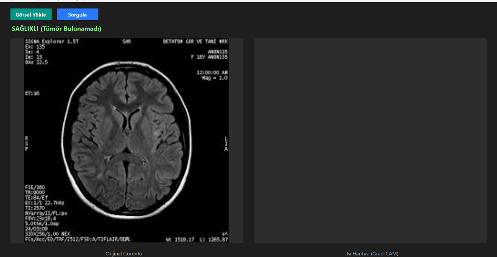
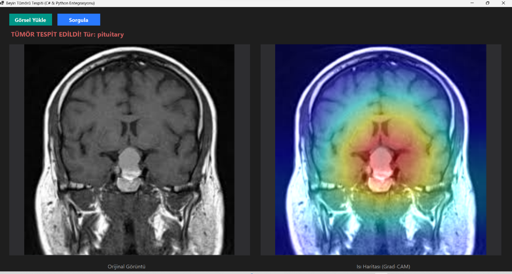
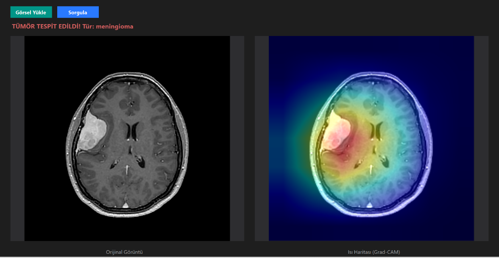
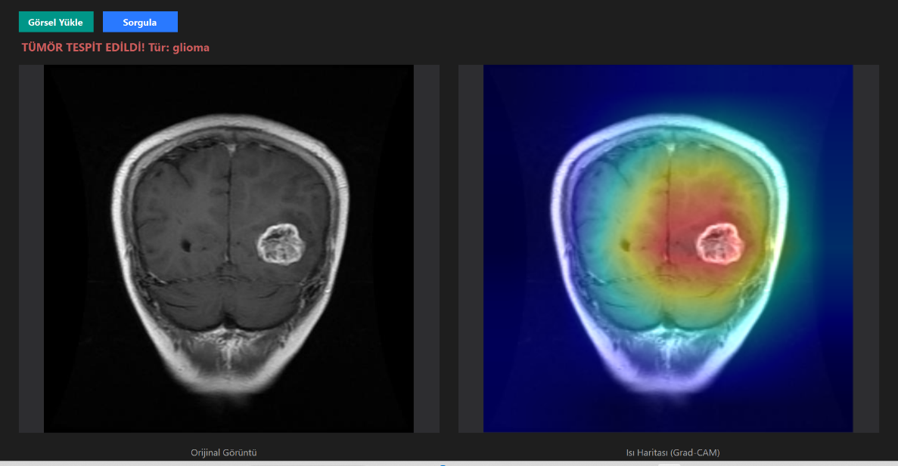
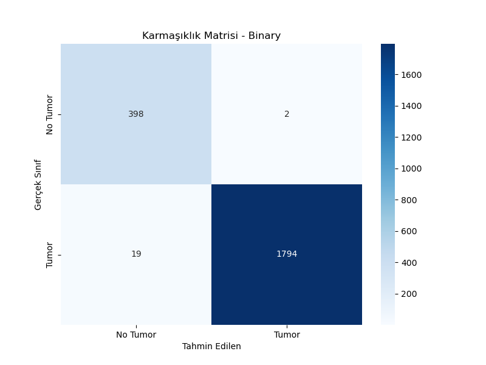
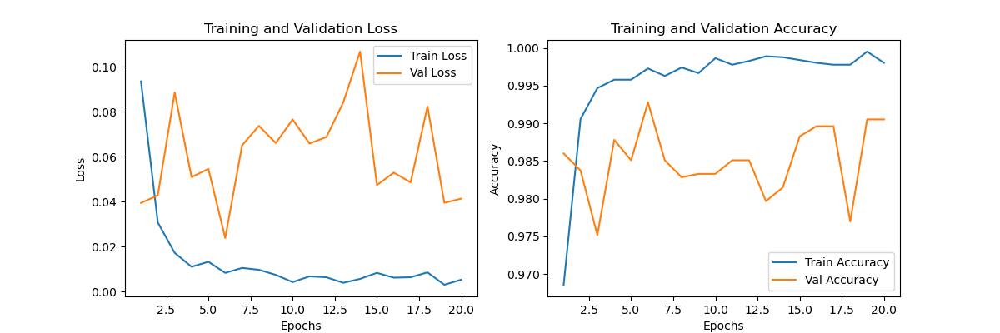
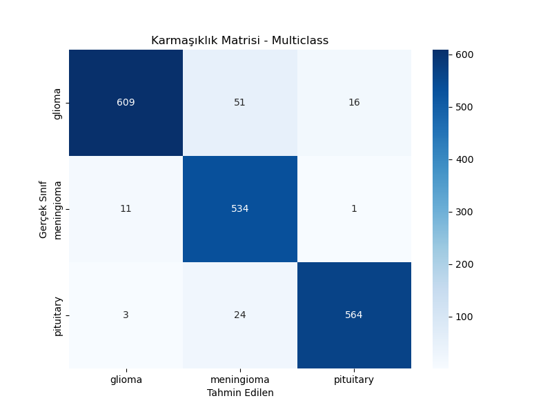
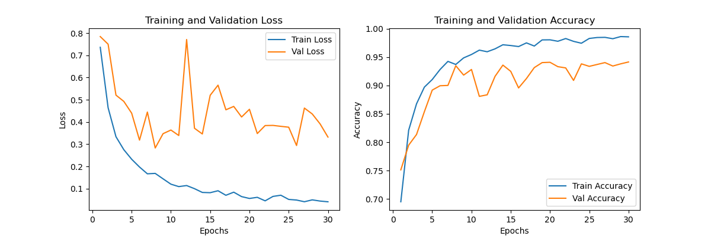

<div align="center">


# 🧠 MRI Görüntülerinden Beyin Tümörü Tespiti ve Sınıflandırılması
### Klinik Karar Destek Sistemi & Açıklanabilir Yapay Zeka (XAI)

**Ders:** Örüntü Tanıma  
**Öğretim Üyesi:** Doç. Dr. Yasemin Gültepe  

**Hazırlayanlar:**  
**Recep Tayyip Yanık** (230710017) &nbsp;|&nbsp; **Samet Pulat** (230710055) &nbsp;|&nbsp; **Furkan Kubat** (220710093)

---

[](https://pytorch.org/)
[](https://dotnet.microsoft.com/)
[](https://onnx.ai/)
[](LICENSE)

</div>

---

## 📋 ÖZET

Bu proje, Manyetik Rezonans Görüntüleme (MRI) verileri üzerinden beyin tümörlerinin otonom tespiti ve sınıflandırılması amacıyla derin öğrenme tabanlı, uçtan uca bir **Klinik Karar Destek Sistemi** geliştirmeyi hedeflemektedir. Modelin tek bir hastane veya cihaz formatını ezberlemesini önlemek amacıyla projede **iki farklı kaynaktan alınan veri setleri (Kaggle resim veri seti ve Figshare `.mat` formatlı medikal veri seti)** birleştirilerek kullanılmıştır. Sistem, tıbbi hata payını en aza indirmek için **2 Aşamalı bir süzgeç mekanizması** (Önce Tümör Var/Yok tespiti, ardından Glioma, Meningioma, Pituitary sınıflandırması) olarak tasarlanmıştır.

Mimari olarak, Transfer Learning destekli **ResNet18** ağı tercih edilmiş ve bu ağın içerisine insan beyninin odaklanma mantığını taklit eden **CBAM (Kanal ve Uzamsal Dikkat Mekanizması)** entegre edilmiştir. Modeller Google Colab üzerindeki bulut GPU'lar (NVIDIA T4) yardımıyla eğitilmiş ve İkili (Binary) sınıflandırmada **%98**, Çok Sınıflı (Multiclass) sınıflandırmada **%96** gibi yüksek doğruluk oranlarına ulaşılmıştır. Son olarak, doktorların yapay zekaya güvenini artırmak amacıyla **Grad-CAM (Açıklanabilir Yapay Zeka - Isı Haritası)** tekniği projeye dahil edilmiş ve tüm arka plan sistemi **C# Windows Forms** ile tasarlanan kullanıcı dostu bir masaüstü arayüzüne entegre edilerek eksiksiz bir yazılım ürünü haline getirilmiştir.

---

## 🎯 1. Projenin Amacı ve Tasarım Mantığı (Neden 2 Aşamalı Yaptık?)

Bu projede amacımız sadece bir resme bakıp sınıflandırma yapan sıradan bir model yapmak değildi. Sistemi gerçek bir doktorun düşünme yapısına benzetmek istedik. Bu yüzden projeyi **2 Aşamalı (Süzgeçli) bir pipeline** olarak tasarladık:

1. **1. Aşama (İkili / Binary):** Hastanın MR'ına bak ve sadece *"Tümör var mı, yok mu?"* sorusuna cevap ver.
2. **2. Aşama (Çok Sınıflı / Multiclass):** Eğer 1. aşama *"Evet tümör var"* dediyse, o zaman *"Peki bu hangi tür? (Glioma, Meningioma, Pituitary)"* diye sor.

> **Neden böyle yaptık?**  
> Çünkü sağlıklı bir beyni doğrudan 4 sınıfın içine sokup tahmin yapmaya çalışmak modelin kafasını karıştırıyor ve doğruluğu düşürüyordu. 2 aşamalı sistemle başarı oranımızı %98 - %99'lara kadar çıkardık.

```text
       [ Hasta MR Görüntüsü ]
                 │
                 ▼
   ┌─────────────────────────────┐
   │ Aşama 1: İkili Sınıflandırma│  ──►  [ SAĞLIKLI ] (Tümör Yok)
   │      (ResNet18 + CBAM)      │
   └─────────────┬───────────────┘
                 │ (Tümör Varsa)
                 ▼
   ┌─────────────────────────────┐
   │ Aşama 2: Çoklu Sınıflama    │  ──►  [ Glioma / Meningioma / Pituitary ]
   │ (Tür Tespiti: ResNet+CBAM)  │
   └─────────────┬───────────────┘
                 │
                 ▼
   ┌─────────────────────────────┐
   │ Grad-CAM Açıklanabilir AI   │  ──►  Renkli Isı Haritası (Heatmap)
   └─────────────┬───────────────┘
                 │
                 ▼
   ┌─────────────────────────────┐
   │     C# Masaüstü Arayüzü     │  ──►  Eşzamanlı Teşhis & Isı Haritası Görseli
   └─────────────────────────────┘
```

---

## 🛠️ 2. Kullanılan Kütüphaneler ve Çerçeveler (Frameworks)

Projede en güncel ve endüstri standardı olan kütüphaneler kullanılmıştır:
- **PyTorch & Torchvision:** Derin öğrenme mimarisini (ResNet) kurmak, modelleri eğitmek ve tensör işlemleri yapmak için (TensorFlow yerine daha dinamik ve akademik araştırmalarda daha sık kullanıldığı için PyTorch seçildi).
- **Scikit-learn:** Hibrit model (CNN + SVM) denemesindeki Destek Vektör Makineleri (SVM) ve başarım metriklerinin hesaplanması için.
- **ONNX:** Eğittiğimiz PyTorch modelini, Python'dan bağımsız olarak C# arayüzünde hızlı ve hatasız çalıştırabilmek adına evrensel formata dönüştürmek için.
- **PIL & OpenCV & Matplotlib & Seaborn:** Medikal görüntüleri okumak, veri dönüşümleri yapmak, ısı haritalarını (Grad-CAM) süperempoze etmek ve sonuç grafiklerini çizdirmek için.

---

## 🔬 3. Mühendislik Çözümleri: MATLAB (.mat) Entegrasyonu ve Özel Veri Okuyucu

*(Projede 2 Farklı Veri Seti Birleştirildi)*

Projedeki en büyük teknik zorluklardan biri, Kaggle'daki normal `.jpg` resimleri ile Figshare'deki tıbbi `.mat` (MATLAB) formatlı verileri aynı anda eğitime sokabilmekti. `.mat` dosyaları normal bir resim gibi okunamaz; içlerinde `cjdata.image` (piksel matrisi) ve `cjdata.label` (etiket) gibi matematiksel diziler barındırır. Bu sorunu çözmek için projemize **Özel Bir PyTorch Veri Sınıfı (`MatlabTumorDataset`)** kodladık:

1. Yazdığımız özel algoritma, her bir `.mat` dosyasını `h5py` ile açıp içindeki ondalıklı sayı (float) matrislerini okudu.
2. Bu dizileri **Min-Max Normalizasyonu** ile 0-255 piksel aralığına çevirip Derin Öğrenme ağının anlayabileceği Tensörlere dönüştürdü.
3. Bu mühendislik dokunuşu sayesinde modelimizi çok daha profesyonel (ham) tıbbi verilerle besleyebildik.

---

## ⚡ 4. Donanım ve Eğitim Ortamı: Neden Google Colab Kullanıldı?

Derin Öğrenme modelleri devasa matris çarpımları gerektirdiği için standart bilgisayar işlemcilerinde (CPU) eğitilmeleri saatler sürebilir. Bu darboğazı aşmak için eğitim sürecimizi **Google Colab** bulut ortamına taşıdık:

- **GPU Hızlandırması (NVIDIA T4):** Colab'ın ücretsiz Tensor Core GPU'ları sayesinde, 10 binden fazla medikal görüntü üzerindeki eğitim sürecini dakikalar içinde (Epoch başına ~2 dakika) tamamlayabildik.
- **Donanım Bağımsızlığı:** Ağırlıklı matematiksel hesaplama yükü gerektiren "Eğitim" (Training) aşamasını bulutta hallettik. Öğrenme işlemi bittikten sonra "akıllanmış" modellerimizi (`.pth` ve `.onnx`) masaüstümüze indirdik ve sadece "Tahmin" (Inference) işlemini yapacak olan C# arayüzümüze entegre ettik. Böylece uygulamayı kullanacak olan son kullanıcının güçlü bir bilgisayara sahip olma zorunluluğunu ortadan kaldırdık.

---

## 🧹 5. Veri Ön İşleme ve Zenginleştirme (Data Preprocessing & Augmentation)

### Neleri, Neden Yaptık?
- **Yeniden Boyutlandırma (Resize 224x224):** ResNet18 mimarisinin giriş katmanı tam olarak bu boyutları beklediği için tüm görselleri bu standarta çektik.
- **Normalizasyon (Min-Max ve Z-Score):** Görüntülerdeki parlaklık farklarını ortadan kaldırmak için `mean=[0.485, 0.456, 0.406]` ve `std=[0.229, 0.224, 0.225]` değerleriyle normalizasyon yaptık. Karanlık çekilmiş bir MR ile aydınlık MR, modelin gözünde aynı matematiksel aralığa oturdu.
- **Veri Artırma (Data Augmentation):** Elimizdeki veriyi rastgele döndürdük, yatay çevirdik ve renkleriyle oynadık. Model hep düz duran bir beyni ezberlemesin, beyin ters veya yan durduğunda da tümörü bulabilsin (Overfitting'i engellemek) için.

### Neleri YAPMADIK ve Neden?
- **Kafatası Soyma (Skull Stripping) YAPMADIK:** Gerçek hayatta hastanede doktor bu programı kullanırken önce kafatasını silmekle uğraşmamalıdır. Modelimizi, ham MR görüntüsünden kemiği ve dokuyu ayırt edebilecek kadar "zor şartlarda" eğittik.
- **Gürültü Azaltma (Median Filter vb.) YAPMADIK:** Aşırı bulanıklaştırma yapan filtreler, tümörün ince kenar hatlarını silebilir. CNN katmanları zaten gürültüleri filtreleyecek matematiksel derinliğe sahiptir.

---

## 📊 6. Makine Öğrenmesi Disiplinleri: Train/Test, Epoch ve Shuffle Mantığı

Modelin gerçekten öğrenip öğrenmediğini (ezber yapıp yapmadığını) kanıtlamak için bilimsel makine öğrenmesi standartlarını harfiyen uyguladık:

- **Neden Veriyi Eğitim (Train) ve Test (Validation) Olarak Ayırdık?**  
  Veri setimizin **%80**'ini eğitime ayırırken, geriye kalan **%20**'lik (Test/Doğrulama) kısmını modelden **tamamen sakladık**. Modelin başarısını (%98 ve %96), daha önce hayatında hiç görmediği bu Test verilerindeki performansına bakarak ölçtük. Böylece modelin piksel ezberlemediğini, tümörün "özelliklerini (feature)" öğrendiğini kanıtladık.
- **Neden Veriyi "Epoch"lara Böldük?**  
  Bir **Epoch**, modelin tüm veri setini baştan sona tam 1 kez görmesi demektir. Eğitimi 20 ve 30 Epoch'lara yaydık. Her bir Epoch'ta model, yaptığı tahminlerdeki hatalarını (Loss) hesaplayıp, ağırlıklarını (Weights) milimetrik olarak düzelterek bir sonraki tura daha akıllı girdi.
- **Neden "Shuffle" (Karıştırma) Yaptık?**  
  Veri yükleyicimizde `shuffle=True` parametresini kullandık. Eğer modele önce art arda 1000 tane sağlıklı MR, sonra 1000 tane tümörlü MR verseydik, modelin karar mekanizması tekdüzeleşirdi. Verileri her Epoch'ta tıpkı bir iskambil destesi gibi karıştırarak, modelin aynı anda hem sağlıklı hem tümörlü MR'ları kıyaslamasını sağladık.

---

## 🧠 7. Derin Öğrenme Mimarisi: Neden ResNet18, CBAM ve Dropout(0.5)?

- **Neden ResNet18?** Çok derin modeller (ResNet50 vb.) medikal verilerde çok çabuk ezber (overfitting) yapar. ResNet18'in Residual (Atlama) bağlantıları sayesinde özellikler kaybolmadan aktarılır. Ayrıca, `IMAGENET1K_V1` ağırlıklarını (Transfer Learning) alıp medikal verilere ince ayar (fine-tuning) yaptık.
- **CBAM (Dikkat Mekanizması - Attention) Eklemesi:** Hazır modeli alıp geçmedik. Modelin içine **CBAM (Kanal ve Uzamsal Dikkat)** modülü kodladık. Tıpkı bir insanın MR'a bakarken simsiyah boşluklara değil de gri lekeli yerlere "odaklanması" gibi, modelin sadece tümör olabilecek noktalara odaklanmasını sağladık.
- **Neden Dropout(0.5) ile Nöronları Kestik?** Modelin çıkış katmanına `nn.Dropout(p=0.5)` ekledik. Bu, eğitim sırasında **nöronların (sinirlerin) %50'sinin rastgele uyutulması** demektir. Eğer tüm nöronlar aktif olursa model kolaya kaçıp ezber yapar. Nöronların yarısını sürekli kapatarak, ağı "zor yoldan her durumu öğrenmeye" mecbur bıraktık.

---

## ⚙️ 8. Optimizasyon ve C# / ONNX Kod Mimari Çözümü

Eğitim sürecinde ağı optimize etmek için şu ayarları kullandık:
- **Loss Function:** Yanlış sınıfa sapan modeli en sert şekilde cezalandıran `CrossEntropyLoss` kullanıldı.
- **Optimizer:** Hız ve ivme momentini çok iyi ayarlayan `Adam` optimizasyonu seçildi (`lr=1e-4`, `weight_decay=1e-4`).
- **Teknik Bir Problem ve Çözümü (ONNX Export Uyumluluğu):**  
  PyTorch'ta eğittiğimiz modeli C#'ta çalışabilen ONNX formatına çevirirken, CBAM dikkat mekanizmasının içindeki `AdaptiveMaxPool2d` katmanının ONNX kütüphanesi tarafından desteklenmediği hatasıyla karşılaştık (Sistem Çökmesi). Mimariyi değiştirmek yerine, ilgili katmanı kod seviyesinde ONNX'in anlayabileceği ham `torch.max` matematiksel işlemlerine dönüştürerek (refactoring) çok ciddi bir platformlar arası uyumluluk (Cross-Platform Compatibility) problemini çözdük.

---

## 🧪 9. Hibrit Model (CNN + SVM) Denemesi ve Sonuçları

Özellik çıkarıcı olarak CNN'i (ResNet) alıp, sınıflandırma kararı için geleneksel **SVM (Destek Vektör Makinesi)** eğittik:
- **Sonuç:** ResNet kendi sınıflandırıcısıyla **%98 - %99** başarıya ulaşırken, SVM'li modelin başarısı **%55**'e düştü.
- **Bilimsel Çıkarım:** Tıbbi görüntüler gibi kompleks verilerde klasik makine öğrenmesinin (SVM) yetersiz kaldığını; uçtan uca (End-to-End) Derin Öğrenme mimarilerinin çok daha üstün olduğunu deneysel olarak kanıtladık.

---

## 🔍 10. Açıklanabilir Yapay Zeka (XAI) ve C# UI Entegrasyonu

Tıp dünyasında doktorlar kapalı kutu yapay zekalara güvenmez. Bu yüzden projeye **Grad-CAM** entegre ettik. Sistem karar verdiği zaman, ResNet'in son evrişim (Convolution) katmanından gradyanları çekerek bir **Isı Haritası** üretiyor. Yani *"Tümör burada, çünkü bu bölgeye odaklandım"* diyebiliyor. Tüm bu yapıyı son kullanıcının (doktorların) bilgisayarında kullanabilmesi için C# Windows Forms arayüzüne (UI) bağlayarak projeyi "gerçek bir ürüne" dönüştürdük.

### Uygulamanın Testi ve XAI (İnternet Üzerinden Alınan, Veri Setine Dahil Olmayan Bağımsız Testler)

Aşağıda internetten bağımsız olarak temin edilen ve modelin eğitiminde hiç yer almayan test MR görüntüleri üzerinde sistemin canlı çalışma ekranları görülmektedir:

<div align="center">

#### Test 1: Glioma Tümörü Tespiti ve Isı Haritası


<br/><br/>

#### Test 2: Meningioma Tümörü Tespiti ve Isı Haritası


<br/><br/>

#### Test 3: Pituitary Tümörü Tespiti ve Isı Haritası


<br/><br/>

#### Test 4: Sağlıklı Beyin Testi (Tümör Bulunamadı)


</div>

---

## 📈 11. Model Eğitimi Çıktıları, Epoch Logları ve Karmaşıklık Matrisleri

Aşağıda hem Google Colab NVIDIA T4 GPU üzerinde gerçekleştirilen **tüm epochların detaylı eğitim ve doğrulama logları**, hem özet tabloları hem de karmaşıklık matrisleri yer almaktadır.

---

### 🔹 Aşama 1: İkili (Binary) Sınıflandırma Eğitimi (20 Epoch)
- **Kullanılan Cihaz:** CUDA (NVIDIA T4 GPU)
- **Eğitim Seti Boyutu:** 8051 MR Görüntüsü
- **Test / Doğrulama Seti Boyutu:** 2213 MR Görüntüsü
- **Test Doğruluğu (Final Test Accuracy):** **%98.33**

#### 📊 Aşama 1: İkili (Binary) Sınıflandırma - 20 Epoch Özeti (Adım Adım Epoch Tablosu)

| Epoch | Eğitim Kaybı (Train Loss) | Eğitim Doğruluğu (Train Acc) | Doğrulama Kaybı (Val Loss) | Doğrulama Doğruluğu (Val Acc) |
|:---:|:---:|:---:|:---:|:---:|
| **Epoch 1** | 0.0966 | %97.16 | 0.0557 | **%98.01** |
| **Epoch 2** | 0.0266 | %99.18 | 0.0473 | **%98.24** |
| **Epoch 3** | 0.0163 | %99.40 | 0.0519 | **%98.51** |
| **Epoch 4** | 0.0155 | %99.53 | 0.0469 | **%98.78** |
| **Epoch 5** | 0.0088 | %99.73 | 0.0653 | **%98.42** |
| **Epoch 6** | 0.0093 | %99.74 | 0.0508 | **%98.78** |
| **Epoch 7** | 0.0106 | %99.73 | 0.0342 | **%98.92** |
| **Epoch 8** | 0.0059 | %99.81 | 0.0685 | **%98.87** |
| **Epoch 9** | 0.0059 | %99.78 | 0.1590 | **%97.56** |
| **Epoch 10** | 0.0093 | %99.68 | 0.0444 | **%98.92** |
| **Epoch 11** | 0.0095 | %99.71 | 0.0409 | **%98.64** |
| **Epoch 12** | 0.0051 | %99.81 | 0.0525 | **%98.96** |
| **Epoch 13** | 0.0017 | %99.95 | 0.1135 | **%98.28** |
| **Epoch 14** | 0.0063 | %99.79 | 0.0339 | **%99.05** |
| **Epoch 15** | 0.0078 | %99.69 | 0.0401 | **%98.87** |
| **Epoch 16** | 0.0032 | %99.90 | 0.0852 | **%98.60** |
| **Epoch 17** | 0.0039 | %99.91 | 0.0709 | **%98.64** |
| **Epoch 18** | 0.0027 | %99.94 | 0.0919 | **%98.15** |
| **Epoch 19** | 0.0095 | %99.73 | 0.0603 | **%98.83** |
| **Epoch 20** | 0.0054 | %99.85 | 0.0865 | **%98.33** |

<br/>

<details open>
<summary><b>🔍 Aşama 1: Terminal Çıktıları ve Detaylı Eğitim Logları (Genişlet / Daralt)</b></summary>

```text
11.Model Eğitimi Çıktısı Ve Oluşan Confusion Matrix
Kullanılan cihaz: cuda
--- AŞAMA 1: İkili (Binary) Sınıflandırma Eğitimi Başlıyor ---
[BINARY] Veri setleri hazirlaniyor...
[BINARY] 3064 adet MATLAB (.mat) verisi bulundu. Entegre ediliyor...
[BINARY] Toplam Egitim Seti: 8051 resim
[BINARY] Toplam Test Seti: 2213 resim
Epoch 1/20
----------
Eğitim: 100% 252/252 [01:55<00:00,  2.19it/s]
Doğrulama: 100% 70/70 [00:14<00:00,  4.70it/s]
Train Loss: 0.0966 Acc: 0.9716
Val Loss: 0.0557 Acc: 0.9801
Epoch 2/20
----------
Eğitim: 100% 252/252 [01:56<00:00,  2.17it/s]
Doğrulama: 100% 70/70 [00:15<00:00,  4.64it/s]
Train Loss: 0.0266 Acc: 0.9918
Val Loss: 0.0473 Acc: 0.9824
Epoch 3/20
----------
Eğitim: 100% 252/252 [01:56<00:00,  2.16it/s]
Doğrulama: 100% 70/70 [00:15<00:00,  4.64it/s]
Train Loss: 0.0163 Acc: 0.9940
Val Loss: 0.0519 Acc: 0.9851
Epoch 4/20
----------
Eğitim: 100% 252/252 [01:57<00:00,  2.14it/s]
Doğrulama: 100% 70/70 [00:14<00:00,  4.72it/s]
Train Loss: 0.0155 Acc: 0.9953
Val Loss: 0.0469 Acc: 0.9878
Epoch 5/20
----------
Eğitim: 100% 252/252 [01:58<00:00,  2.13it/s]
Doğrulama: 100% 70/70 [00:15<00:00,  4.62it/s]
Train Loss: 0.0088 Acc: 0.9973
Val Loss: 0.0653 Acc: 0.9842
Epoch 6/20
----------
Eğitim: 100% 252/252 [01:56<00:00,  2.16it/s]
Doğrulama: 100% 70/70 [00:14<00:00,  4.69it/s]
Train Loss: 0.0093 Acc: 0.9974
Val Loss: 0.0508 Acc: 0.9878
Epoch 7/20
----------
Eğitim: 100% 252/252 [01:57<00:00,  2.14it/s]
Doğrulama: 100% 70/70 [00:14<00:00,  4.67it/s]
Train Loss: 0.0106 Acc: 0.9973
Val Loss: 0.0342 Acc: 0.9892
Epoch 8/20
----------
Eğitim: 100% 252/252 [02:00<00:00,  2.09it/s]
Doğrulama: 100% 70/70 [00:15<00:00,  4.58it/s]
Train Loss: 0.0059 Acc: 0.9981
Val Loss: 0.0685 Acc: 0.9887
Epoch 9/20
----------
Eğitim: 100% 252/252 [01:59<00:00,  2.12it/s]
Doğrulama: 100% 70/70 [00:15<00:00,  4.60it/s]
Train Loss: 0.0059 Acc: 0.9978
Val Loss: 0.1590 Acc: 0.9756
Epoch 10/20
----------
Eğitim: 100% 252/252 [02:01<00:00,  2.08it/s]
Doğrulama: 100% 70/70 [00:14<00:00,  4.73it/s]
Train Loss: 0.0093 Acc: 0.9968
Val Loss: 0.0444 Acc: 0.9892
Epoch 11/20
----------
Eğitim: 100% 252/252 [01:55<00:00,  2.19it/s]
Doğrulama: 100% 70/70 [00:14<00:00,  4.78it/s]
Train Loss: 0.0095 Acc: 0.9971
Val Loss: 0.0409 Acc: 0.9864
Epoch 12/20
----------
Eğitim: 100% 252/252 [01:55<00:00,  2.17it/s]
Doğrulama: 100% 70/70 [00:14<00:00,  4.75it/s]
Train Loss: 0.0051 Acc: 0.9981
Val Loss: 0.0525 Acc: 0.9896
Epoch 13/20
----------
Eğitim: 100% 252/252 [02:01<00:00,  2.08it/s]
Doğrulama: 100% 70/70 [00:15<00:00,  4.57it/s]
Train Loss: 0.0017 Acc: 0.9995
Val Loss: 0.1135 Acc: 0.9828
Epoch 14/20
----------
Eğitim: 100% 252/252 [02:00<00:00,  2.09it/s]
Doğrulama: 100% 70/70 [00:15<00:00,  4.57it/s]
Train Loss: 0.0063 Acc: 0.9979
Val Loss: 0.0339 Acc: 0.9905
Epoch 15/20
----------
Eğitim: 100% 252/252 [01:59<00:00,  2.12it/s]
Doğrulama: 100% 70/70 [00:15<00:00,  4.63it/s]
Train Loss: 0.0078 Acc: 0.9969
Val Loss: 0.0401 Acc: 0.9887
Epoch 16/20
----------
Eğitim: 100% 252/252 [01:58<00:00,  2.12it/s]
Doğrulama: 100% 70/70 [00:15<00:00,  4.61it/s]
Train Loss: 0.0032 Acc: 0.9990
Val Loss: 0.0852 Acc: 0.9860
Epoch 17/20
----------
Eğitim: 100% 252/252 [01:59<00:00,  2.10it/s]
Doğrulama: 100% 70/70 [00:15<00:00,  4.64it/s]
Train Loss: 0.0039 Acc: 0.9991
Val Loss: 0.0709 Acc: 0.9864
Epoch 18/20
----------
Eğitim: 100% 252/252 [01:58<00:00,  2.13it/s]
Doğrulama: 100% 70/70 [00:15<00:00,  4.61it/s]
Train Loss: 0.0027 Acc: 0.9994
Val Loss: 0.0919 Acc: 0.9815
Epoch 19/20
----------
Eğitim: 100% 252/252 [01:58<00:00,  2.13it/s]
Doğrulama: 100% 70/70 [00:15<00:00,  4.54it/s]
Train Loss: 0.0095 Acc: 0.9973
Val Loss: 0.0603 Acc: 0.9883
Epoch 20/20
----------
Eğitim: 100% 252/252 [01:57<00:00,  2.14it/s]
Doğrulama: 100% 70/70 [00:15<00:00,  4.62it/s]
Train Loss: 0.0054 Acc: 0.9985
Val Loss: 0.0865 Acc: 0.9833
--- BINARY SINIFLANDIRMA RAPORU ---
precision     recall       f1-score     support
No Tumor                0.92            1.00              0.96           400
Tumor                    1.00              0.98             0.99         1813
accuracy                                                                0.98         2213
macro avg                0.96              0.99               0.97        2213
weighted avg              0.98              0.98               0.98        2213
[torch.onnx] Obtain model graph for `ResNet([...]` with `torch.export.export(..., strict=False)`...
[torch.onnx] Obtain model graph for `ResNet([...]` with `torch.export.export(..., strict=False)`... ✅
[torch.onnx] Run decompositions...
/usr/lib/python3.12/copyreg.py:99: FutureWarning: `isinstance(treespec, LeafSpec)` is deprecated, use `isinstance(treespec, TreeSpec) and treespec.is_leaf()` instead.
return cls.__new__(cls, *args)
[torch.onnx] Run decompositions... ✅
[torch.onnx] Translate the graph into ONNX...
[torch.onnx] Translate the graph into ONNX... ✅
[torch.onnx] Optimize the ONNX graph...
[torch.onnx] Optimize the ONNX graph... ✅
Binary model /content/proje/örüntüTanımaProje/saved_models/binary_model.onnx olarak kaydedildi (C# için).
```

</details>

<br/>

<div align="center">
<table>
  <tr>
    <td align="center"><b>Binary Karmaşıklık Matrisi (Confusion Matrix)</b></td>
    <td align="center"><b>Binary Eğitim ve Doğrulama Kayıp / Başarım Grafiği</b></td>
  </tr>
  <tr>
    <td></td>
    <td></td>
  </tr>
</table>
</div>

---

### 🔹 Aşama 2: Çok Sınıflı (Multiclass) Sınıflandırma Eğitimi (30 Epoch)
- **Kullanılan Cihaz:** CUDA (NVIDIA T4 GPU)
- **Eğitim Seti Boyutu:** 6651 MR Görüntüsü
- **Test / Doğrulama Seti Boyutu:** 1813 MR Görüntüsü
- **Test Doğruluğu (Final Test Accuracy):** **%95.59 - %96.19**

#### 📊 Aşama 2: Çok Sınıflı (Multiclass) Sınıflandırma - 30 Epoch Özeti (Adım Adım Epoch Tablosu)

| Epoch | Eğitim Kaybı (Train Loss) | Eğitim Doğruluğu (Train Acc) | Doğrulama Kaybı (Val Loss) | Doğrulama Doğruluğu (Val Acc) |
|:---:|:---:|:---:|:---:|:---:|
| **Epoch 1** | 0.3164 | %87.78 | 0.2408 | **%92.83** |
| **Epoch 2** | 0.1392 | %94.95 | 0.2187 | **%94.04** |
| **Epoch 3** | 0.1008 | %96.36 | 0.3356 | **%93.71** |
| **Epoch 4** | 0.0760 | %97.43 | 0.3773 | **%92.00** |
| **Epoch 5** | 0.0608 | %97.86 | 0.3142 | **%93.77** |
| **Epoch 6** | 0.0506 | %98.20 | 0.2405 | **%94.98** |
| **Epoch 7** | 0.0495 | %98.41 | 0.2460 | **%95.15** |
| **Epoch 8** | 0.0442 | %98.53 | 0.2894 | **%95.31** |
| **Epoch 9** | 0.0297 | %99.05 | 0.3281 | **%93.99** |
| **Epoch 10** | 0.0348 | %98.78 | 0.3105 | **%95.26** |
| **Epoch 11** | 0.0260 | %99.22 | 0.2377 | **%95.59** |
| **Epoch 12** | 0.0351 | %98.92 | 0.2097 | **%95.92** |
| **Epoch 13** | 0.0205 | %99.34 | 0.2891 | **%95.42** |
| **Epoch 14** | 0.0349 | %98.77 | 0.2852 | **%95.09** |
| **Epoch 15** | 0.0240 | %99.14 | 0.1807 | **%96.19** |
| **Epoch 16** | 0.0209 | %99.32 | 0.3583 | **%94.87** |
| **Epoch 17** | 0.0287 | %99.13 | 0.2295 | **%95.92** |
| **Epoch 18** | 0.0158 | %99.49 | 0.2589 | **%95.53** |
| **Epoch 19** | 0.0174 | %99.37 | 0.2888 | **%94.76** |
| **Epoch 20** | 0.0158 | %99.43 | 0.3406 | **%95.53** |
| **Epoch 21** | 0.0255 | %99.04 | 0.3075 | **%95.53** |
| **Epoch 22** | 0.0148 | %99.49 | 0.2764 | **%95.86** |
| **Epoch 23** | 0.0206 | %99.28 | 0.5606 | **%93.22** |
| **Epoch 24** | 0.0274 | %99.02 | 0.2910 | **%94.87** |
| **Epoch 25** | 0.0236 | %99.26 | 0.4656 | **%93.33** |
| **Epoch 26** | 0.0106 | %99.67 | 0.3388 | **%95.97** |
| **Epoch 27** | 0.0250 | %99.23 | 0.2949 | **%95.75** |
| **Epoch 28** | 0.0180 | %99.35 | 0.2623 | **%95.81** |
| **Epoch 29** | 0.0120 | %99.65 | 0.2992 | **%95.53** |
| **Epoch 30** | 0.0154 | %99.50 | 0.3441 | **%95.59** |

<br/>

<details open>
<summary><b>🔍 Aşama 2: Terminal Çıktıları ve Detaylı Eğitim Logları (Genişlet / Daralt)</b></summary>

```text
--- AŞAMA 2: Çok Sınıflı (Multiclass) Sınıflandırma Eğitimi Başlıyor ---
[MULTICLASS] Veri setleri hazirlaniyor...
[MULTICLASS] 3064 adet MATLAB (.mat) verisi bulundu. Entegre ediliyor...
[MULTICLASS] Toplam Egitim Seti: 6651 resim
[MULTICLASS] Toplam Test Seti: 1813 resim
Epoch 1/30
----------
Eğitim: 100% 208/208 [01:40<00:00,  2.06it/s]
Doğrulama: 100% 57/57 [00:13<00:00,  4.21it/s]
Train Loss: 0.3164 Acc: 0.8778
Val Loss: 0.2408 Acc: 0.9283
Epoch 2/30
----------
Eğitim: 100% 208/208 [01:42<00:00,  2.03it/s]
Doğrulama: 100% 57/57 [00:13<00:00,  4.27it/s]
Train Loss: 0.1392 Acc: 0.9495
Val Loss: 0.2187 Acc: 0.9404
Epoch 3/30
----------
Eğitim: 100% 208/208 [01:42<00:00,  2.03it/s]
Doğrulama: 100% 57/57 [00:13<00:00,  4.29it/s]
Train Loss: 0.1008 Acc: 0.9636
Val Loss: 0.3356 Acc: 0.9371
Epoch 4/30
----------
Eğitim: 100% 208/208 [01:42<00:00,  2.03it/s]
Doğrulama: 100% 57/57 [00:13<00:00,  4.20it/s]
Train Loss: 0.0760 Acc: 0.9743
Val Loss: 0.3773 Acc: 0.9200
Epoch 5/30
----------
Eğitim: 100% 208/208 [01:41<00:00,  2.05it/s]
Doğrulama: 100% 57/57 [00:13<00:00,  4.21it/s]
Train Loss: 0.0608 Acc: 0.9786
Val Loss: 0.3142 Acc: 0.9377
Epoch 6/30
----------
Eğitim: 100% 208/208 [01:41<00:00,  2.05it/s]
Doğrulama: 100% 57/57 [00:13<00:00,  4.17it/s]
Train Loss: 0.0506 Acc: 0.9820
Val Loss: 0.2405 Acc: 0.9498
Epoch 7/30
----------
Eğitim: 100% 208/208 [01:40<00:00,  2.07it/s]
Doğrulama: 100% 57/57 [00:13<00:00,  4.21it/s]
Train Loss: 0.0495 Acc: 0.9841
Val Loss: 0.2460 Acc: 0.9515
Epoch 8/30
----------
Eğitim: 100% 208/208 [01:41<00:00,  2.05it/s]
Doğrulama: 100% 57/57 [00:13<00:00,  4.22it/s]
Train Loss: 0.0442 Acc: 0.9853
Val Loss: 0.2894 Acc: 0.9531
Epoch 9/30
----------
Eğitim: 100% 208/208 [01:41<00:00,  2.05it/s]
Doğrulama: 100% 57/57 [00:13<00:00,  4.27it/s]
Train Loss: 0.0297 Acc: 0.9905
Val Loss: 0.3281 Acc: 0.9399
Epoch 10/30
----------
Eğitim: 100% 208/208 [01:39<00:00,  2.09it/s]
Doğrulama: 100% 57/57 [00:13<00:00,  4.31it/s]
Train Loss: 0.0348 Acc: 0.9878
Val Loss: 0.3105 Acc: 0.9526
Epoch 11/30
----------
Eğitim: 100% 208/208 [01:40<00:00,  2.07it/s]
Doğrulama: 100% 57/57 [00:13<00:00,  4.08it/s]
Train Loss: 0.0260 Acc: 0.9922
Val Loss: 0.2377 Acc: 0.9559
Epoch 12/30
----------
Eğitim: 100% 208/208 [01:44<00:00,  1.99it/s]
Doğrulama: 100% 57/57 [00:13<00:00,  4.15it/s]
Train Loss: 0.0351 Acc: 0.9892
Val Loss: 0.2097 Acc: 0.9592
Epoch 13/30
----------
Eğitim: 100% 208/208 [01:43<00:00,  2.02it/s]
Doğrulama: 100% 57/57 [00:13<00:00,  4.27it/s]
Train Loss: 0.0205 Acc: 0.9934
Val Loss: 0.2891 Acc: 0.9542
Epoch 14/30
----------
Eğitim: 100% 208/208 [01:42<00:00,  2.02it/s]
Doğrulama: 100% 57/57 [00:13<00:00,  4.19it/s]
Train Loss: 0.0349 Acc: 0.9877
Val Loss: 0.2852 Acc: 0.9509
Epoch 15/30
----------
Eğitim: 100% 208/208 [01:41<00:00,  2.04it/s]
Doğrulama: 100% 57/57 [00:13<00:00,  4.18it/s]
Train Loss: 0.0240 Acc: 0.9914
Val Loss: 0.1807 Acc: 0.9619
Epoch 16/30
----------
Eğitim: 100% 208/208 [01:41<00:00,  2.04it/s]
Doğrulama: 100% 57/57 [00:13<00:00,  4.30it/s]
Train Loss: 0.0209 Acc: 0.9932
Val Loss: 0.3583 Acc: 0.9487
Epoch 17/30
----------
Eğitim: 100% 208/208 [01:39<00:00,  2.09it/s]
Doğrulama: 100% 57/57 [00:13<00:00,  4.36it/s]
Train Loss: 0.0287 Acc: 0.9913
Val Loss: 0.2295 Acc: 0.9592
Epoch 18/30
----------
Eğitim: 100% 208/208 [01:39<00:00,  2.09it/s]
Doğrulama: 100% 57/57 [00:13<00:00,  4.25it/s]
Train Loss: 0.0158 Acc: 0.9949
Val Loss: 0.2589 Acc: 0.9553
Epoch 19/30
----------
Eğitim: 100% 208/208 [01:40<00:00,  2.06it/s]
Doğrulama: 100% 57/57 [00:13<00:00,  4.24it/s]
Train Loss: 0.0174 Acc: 0.9937
Val Loss: 0.2888 Acc: 0.9476
Epoch 20/30
----------
Eğitim: 100% 208/208 [01:40<00:00,  2.06it/s]
Doğrulama: 100% 57/57 [00:13<00:00,  4.26it/s]
Train Loss: 0.0158 Acc: 0.9943
Val Loss: 0.3406 Acc: 0.9553
Epoch 21/30
----------
Eğitim: 100% 208/208 [01:42<00:00,  2.03it/s]
Doğrulama: 100% 57/57 [00:13<00:00,  4.09it/s]
Train Loss: 0.0255 Acc: 0.9904
Val Loss: 0.3075 Acc: 0.9553
Epoch 22/30
----------
Eğitim: 100% 208/208 [01:43<00:00,  2.02it/s]
Doğrulama: 100% 57/57 [00:13<00:00,  4.18it/s]
Train Loss: 0.0148 Acc: 0.9949
Val Loss: 0.2764 Acc: 0.9586
Epoch 23/30
----------
Eğitim: 100% 208/208 [01:40<00:00,  2.07it/s]
Doğrulama: 100% 57/57 [00:13<00:00,  4.32it/s]
Train Loss: 0.0206 Acc: 0.9928
Val Loss: 0.5606 Acc: 0.9322
Epoch 24/30
----------
Eğitim: 100% 208/208 [01:39<00:00,  2.09it/s]
Doğrulama: 100% 57/57 [00:13<00:00,  4.18it/s]
Train Loss: 0.0274 Acc: 0.9902
Val Loss: 0.2910 Acc: 0.9487
Epoch 25/30
----------
Eğitim: 100% 208/208 [01:41<00:00,  2.05it/s]
Doğrulama: 100% 57/57 [00:12<00:00,  4.43it/s]
Train Loss: 0.0236 Acc: 0.9926
Val Loss: 0.4656 Acc: 0.9333
Epoch 26/30
----------
Eğitim: 100% 208/208 [01:40<00:00,  2.07it/s]
Doğrulama: 100% 57/57 [00:13<00:00,  4.35it/s]
Train Loss: 0.0106 Acc: 0.9967
Val Loss: 0.3388 Acc: 0.9597
Epoch 27/30
----------
Eğitim: 100% 208/208 [01:38<00:00,  2.10it/s]
Doğrulama: 100% 57/57 [00:12<00:00,  4.42it/s]
Train Loss: 0.0250 Acc: 0.9923
Val Loss: 0.2949 Acc: 0.9575
Epoch 28/30
----------
Eğitim: 100% 208/208 [01:38<00:00,  2.11it/s]
Doğrulama: 100% 57/57 [00:13<00:00,  4.28it/s]
Train Loss: 0.0180 Acc: 0.9935
Val Loss: 0.2623 Acc: 0.9581
Epoch 29/30
----------
Eğitim: 100% 208/208 [01:38<00:00,  2.10it/s]
Doğrulama: 100% 57/57 [00:13<00:00,  4.26it/s]
Train Loss: 0.0120 Acc: 0.9965
Val Loss: 0.2992 Acc: 0.9553
Epoch 30/30
----------
Eğitim: 100% 208/208 [01:38<00:00,  2.10it/s]
Doğrulama: 100% 57/57 [00:13<00:00,  4.35it/s]
Train Loss: 0.0154 Acc: 0.9950
Val Loss: 0.3441 Acc: 0.9559
--- MULTICLASS SINIFLANDIRMA RAPORU ---
precision    recall    f1-score      support
glioma               0.99             0.90        0.94           677
meningioma       0.91             0.97        0.94           549
pituitary               0.96             1.00         0.98           587
accuracy                                                      0.96      1813
macro avg            0.96             0.96         0.96      1813
weighted avg          0.96             0.96         0.96      1813
```

</details>

<br/>

<div align="center">
<table>
  <tr>
    <td align="center"><b>Çok Sınıflı Karmaşıklık Matrisi</b></td>
    <td align="center"><b>Çok Sınıflı Eğitim ve Doğrulama Kayıp / Başarım Grafiği</b></td>
  </tr>
  <tr>
    <td></td>
    <td></td>
  </tr>
</table>
</div>

---

## 💻 12. Kurulum ve Çalıştırma

### 1. Depoyu Klonlayın
```bash
git clone https://github.com/receptayyipyanik/brain-tumor-detection-xai.git
cd brain-tumor-detection-xai
```

### 2. Bağımlılıkları Yükleyin
```bash
pip install -r requirements.txt
```

### 3. Uygulamayı Başlatın
- **Masaüstü Arayüzü (C# Windows Forms):**
  ```powershell
  dotnet run --project kod\TumorUI
  ```
  *(veya `kod/TumorUI/bin/Debug/net9.0-windows/TumorUI.exe` dosyasına çift tıklayın)*
- **Terminalden Test:**
  ```bash
  python kod/inference.py --image "test_ornek.jpg"
  ```
- **Web Tarayıcısı Üzerinden (Gradio):**
  ```bash
  python kod/app_web.py
  ```

---

## 📜 13. Lisans ve Kullanım Koşulları

Bu yazılım ve ilgili tüm dosyalar **[EĞİTİM VE AKADEMİK ARAŞTIRMA LİSANSI (Educational & Non-Commercial Use Only)](LICENSE)** kapsamında sunulmaktadır.

> [!WARNING]
> - **Yalnızca Eğitim Amaçlıdır:** Bu proje; üniversite dersleri, akademik araştırmalar ve bireysel öğrenim amacıyla hazırlanmıştır.
> - **Ticari Kullanım Yasaktır:** Projenin veya modellerin doğrudan ya da dolaylı olarak herhangi bir ticari amaçla satılması, kiralanması veya dağıtılması kesinlikle yasaktır.
> - **Tıbbi Cihaz Değildir:** Bu yazılım klinik tanı veya tedavi amacıyla kullanılamaz; gerçek hastalar üzerinde teşhis kararı vermek için uygun değildir.
